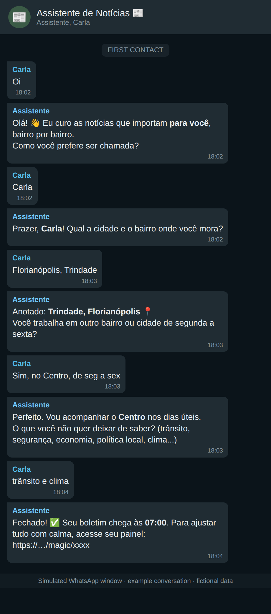
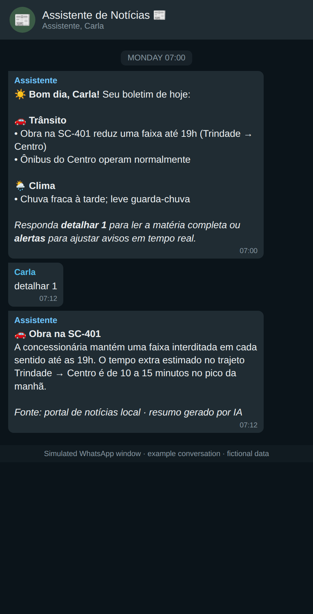
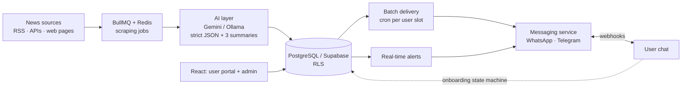

<div align="center">

# 📰 AI Local: a hyperlocal news curator on WhatsApp and Telegram

### Scrapers collect the news, an LLM tags and summarizes it, and each person gets a personal bulletin for the places they care about


</div>

---

## What is it?

An **interactive AI curator** that lives in the messaging apps people already use. It does not wait for news to arrive: it
**scrapes sources on a schedule**, uses an LLM to understand where each story happens, how far it reaches and which topics it
covers, and then delivers a **personal bulletin** matched to each user's neighborhoods, interests and preferred times.

## 💬 What the conversation looks like

> These are **simulated WhatsApp windows** (example messages, fictional user), not captures of a production chat.

<table>
<tr>
<td width="50%" valign="top">

**Onboarding inside the chat**


*A short state machine collects name, home area, workdays and work area, and interests, then sends a magic link to the web portal for fine tuning.*

</td>
<td width="50%" valign="top">

**Daily bulletin**


*One consolidated message at the user's chosen time. Replying asks for the full summary of an item.*

</td>
</tr>
</table>

## ✨ How it works

1. **Ingestion**: BullMQ jobs (Redis) poll each registered source (RSS/APIs, or a headless browser for dynamic pages) at its own interval and sanitize the text.
2. **AI processing**: a provider abstraction (`IAIProvider`, with **Gemini** and **Ollama** implementations) sends the text with an editable system prompt and requires **strict JSON**: tags, geographic scope level, political-bias signal and **three summary sizes** (short alert, bullets, detailed). Each story is processed once and reused for every reader.
3. **Matching**: stories are matched to users by location zones (including different places on different weekdays), topic tags and preferences.
4. **Delivery**: **batching** is the default (one aggregated bulletin per user per delivery slot, which keeps messaging cost and spam low); **real-time alerts** are the exception for high-impact local events.
5. **Conversation**: webhooks for WhatsApp and Telegram feed a state machine for onboarding and commands.
6. **Web portal and admin**: React app for users (plan, locations, delivery preferences) and an admin dashboard (sources, prompts, campaigns, metrics).

## 🏗️ Architecture



```text
assistant_backend/
  src/modules/
    scraping/     scraper service and BullMQ jobs
    ai/           provider factory (Gemini, Ollama), prompt service
    messaging/    inbound webhooks and outbound sends
    users/        onboarding state machine
    delivery/     batch bulletins
    marketing/    campaigns
  prisma/         database schema
  docs/           architecture, schema, messaging, AI/scraping, frontend (PT-BR design docs)
  assistant_web/  React + Vite + Tailwind frontend
docker-compose.yml  backend, frontend, Postgres, Redis, Supabase services
```

## 🚀 Getting started

Prerequisites: Node.js 18+, npm, Docker.

```bash
git clone https://github.com/pjaragao/AI_Local.git && cd AI_Local

# backend
cd assistant_backend && npm install
cp .env.example .env && npx prisma generate
npm run dev

# frontend (another terminal)
cd assistant_backend/assistant_web && npm install && npm run dev
```

Or the whole stack with Docker Compose:

```bash
docker compose up -d --build
```

The design documents in [`assistant_backend/docs`](assistant_backend/docs) (Portuguese) describe the architecture, database schema,
messaging engine, AI/scraping pipeline and frontend in detail.

---

<div align="center">

Built by **Paulo Aragão Jr** · [GitHub](https://github.com/pjaragao) · for WhatsApp agents in production see [mr-irrelevant](https://github.com/pjaragao/mr-irrelevant) and [lolo-bot](https://github.com/pjaragao/lolo-bot)

</div>
