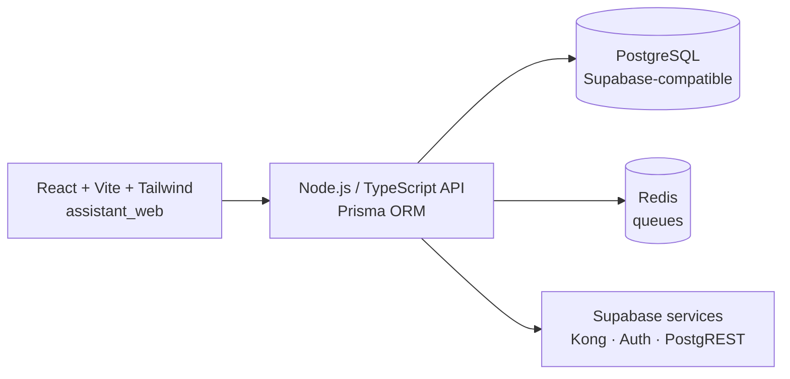

<div align="center">

# 🧠 AI Local: assistant backend + web UI

### A self-hostable AI assistant platform: Node/TypeScript API, React frontend, Postgres, Redis and Supabase services


</div>

---

## What is it?

A broadly scoped AI assistant project made of a **backend service** and a **web interface**, packaged so the whole stack runs
locally with one command. For WhatsApp-based agents see [lolo-bot](https://github.com/pjaragao/lolo-bot) and
[mr-irrelevant](https://github.com/pjaragao/mr-irrelevant).

## 🏗️ Architecture



```text
assistant_backend/                Node.js + TypeScript backend (Prisma, Docker)
assistant_backend/assistant_web/  React + Vite + Tailwind frontend
docker-compose.yml                backend, frontend, Postgres, Redis, Supabase services
```

## 🚀 Getting started

Prerequisites: Node.js 18+, npm, Docker.

```bash
git clone https://github.com/pjaragao/AI_Local.git && cd AI_Local

# backend
cd assistant_backend && npm install
cp .env.example .env && npx prisma generate
npm run dev

# frontend (another terminal)
cd assistant_backend/assistant_web && npm install && npm run dev
```

Everything at once with Docker Compose:

```bash
docker compose up -d --build
```

---

<div align="center">

Built by **Paulo Aragão Jr** · [GitHub](https://github.com/pjaragao)

</div>
